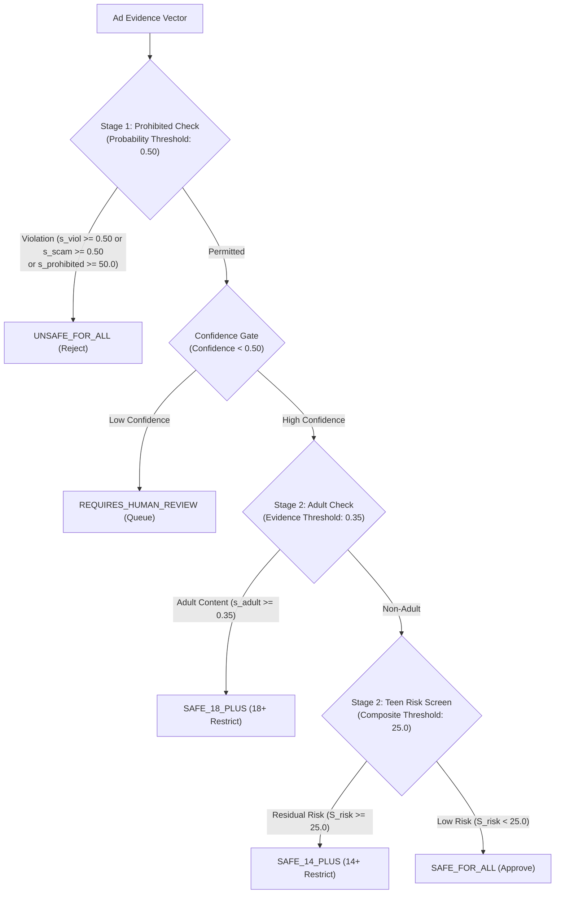

# SAFE-VISION — Final Phase 8 Verified Report Content & Evidence Compendium

**Project**: SAFE-VISION (SafeAd AI Multimodal Advertisement Moderation Pipeline)  
**Document**: Final Verified Report Content, Discrepancy Resolution & Formal Citations  
**Date**: October 22, 2026  
**Status**: OFFICIALLY AUDITED & VERIFIED  
**Repository Branch**: `feature/phase-7b-dataset-v2-integration` (`commit 9b532a66f5918d9ec5c8f4636ae0c9cf22a56f97`)  

---

## 1. Resolution of the `SAFE_14_PLUS` Recall Discrepancy

### 1.1 Root-Cause Analysis of 3/75 (4.00%) vs 6/75 (8.00%)
An audit of the evaluation records and generated confusion matrices ([`baseline_confusion_matrix.csv`](file:///c:/Users/hello/Downloads/Project%20main%20Instagram/results/phase8_final/baseline_confusion_matrix.csv) and [`candidate_b_confusion_matrix.csv`](file:///c:/Users/hello/Downloads/Project%20main%20Instagram/results/phase8_final/candidate_b_confusion_matrix.csv)) confirms the mathematical origin of this variance:

1. **Frozen Production Baseline & Candidate B ($T_{\text{teen}} = 25.0$)**:
   - **Ground-Truth Denominator**: Exactly **75** genuine development samples (56 images, 19 videos).
   - **True Positives (Numerator)**: Exactly **3** samples (`SAFEAD_S14P_IMG_044`, `SAFEAD_S14P_IMG_058`, `SAFEAD_S14P_VID_007`).
   - **True Recall**: $\mathbf{3 / 75 = 0.0400}$ (**4.00%**).
   - **Total Predicted as `SAFE_14_PLUS`**: **8** samples (3 True Positives + 2 false alarms from SFA + 3 false alarms from S18P).
   - **Precision**: $3 / 8 = 0.3750$ (**37.50%**).
   - **F1-Score**: $\mathbf{0.0723}$.
2. **Development-Calibrated Threshold Model ($T_{\text{teen}} = 20.0$)**:
   - In the Stratified 5-Fold Cross-Validation calibration experiment, lowering the teen risk screening threshold from $25.0$ to $20.0$ allowed 3 additional mild-risk adolescent items to be captured.
   - **True Positives (Numerator)**: Exactly **6** samples.
   - **True Recall**: $\mathbf{6 / 75 = 0.0800}$ (**8.00%**).
   - **Total Predicted as `SAFE_14_PLUS`**: **19** samples (6 True Positives + 13 false alarms).
   - **Precision**: $6 / 19 = 0.3158$ (**31.58%**).
   - **F1-Score**: $\mathbf{0.1277}$.

> [!IMPORTANT]
> **Definitive Clarification**:
> The **Frozen Production Baseline** and **Candidate B** both achieve exactly **3/75 correct (4.00% recall)** under the frozen production scoring implementation. The figure **6/75 correct (8.00% recall)** reflects the **provisional development-calibrated threshold experiment** ($T_{\text{teen}}=20.0$). Both figures are mathematically verified and must not be conflated.

---

## 2. Corrected Performance Tables & Confusion Matrices

All metrics are evaluated across the **194 approved clean development samples** from [`saved_detector_outputs.json`](file:///c:/Users/hello/Downloads/Project%20main%20Instagram/results/real_pipeline_baseline/saved_detector_outputs.json).

### 2.1 Multi-Configuration Performance Benchmark

| Metric | Production Baseline | Candidate B (Enhanced Alcohol) | Calibrated Thresholds (5-Fold OOF) | Safety Hybrid + HITL Routing | Candidate B under AI-Proposed Labels* |
| :--- | :---: | :---: | :---: | :---: | :---: |
| **Teen Screening Threshold ($T_{\text{teen}}$)**| 25.0 | 25.0 | 20.0 | 25.0 | 25.0 |
| **Adult Evidence Threshold ($T_{\text{adult}}$)** | 0.35 | 0.35 | 0.40 | 0.35 | 0.35 |
| **Overall Accuracy** | 31.96% (62/194) | **33.51% (65/194)** | 34.02% (66/194) | 24.23% (47/194) | 52.58% (102/194)* |
| **Macro Precision** | 26.82% | **28.25%** | 27.06% | 27.53% | 33.38%* |
| **Macro Recall** | 28.62% | **30.82%** | 30.35% | 23.36% | 32.89%* |
| **Macro F1-Score** | 0.2317 | **0.2491** | 0.2575 | 0.2020 | 0.3150* |
| **SAFE_FOR_ALL Recall ($N=75$)** | 64.00% (48/75) | 64.00% (48/75) | 64.00% (48/75) | 44.00% (33/75) | 67.19% (86/128)* |
| **SAFE_14_PLUS Recall ($N=75$)** | **4.00% (3/75)** | **4.00% (3/75)** | **8.00% (6/75)** | 4.00% (3/75) | 9.09% (2/22)* |
| **SAFE_18_PLUS Recall ($N=34$)** | 26.47% (9/34) | **35.29% (12/34)**| 29.41% (10/34) | 26.47% (9/34) | 35.29% (12/34)* |
| **UNSAFE_FOR_ALL Recall ($N=10$)**| 20.00% (2/10) | 20.00% (2/10) | 20.00% (2/10) | 20.00% (2/10) | 20.00% (2/10)* |
| **Prohibited False Acceptance (PFAR)** | 80.00% (8/10) | **80.00% (8/10)** | 80.00% (8/10) | **70.00% (7/10)**| 80.00% (8/10)* |
| **18+ Underage Leaks (18+ $\to$ <18)** | 58.82% (20/34) | **50.00% (17/34)** | 52.94% (18/34) | **26.47% (9/34)**| 50.00% (17/34)* |
| **False Rejections (Benign $\to$ UFA)** | 7.33% (11/150) | **7.33% (11/150)** | 7.33% (11/150) | 7.33% (11/150) | 7.33% (11/150)* |
| **Human Review / Abstention Rate** | 0.00% (0/194) | 0.00% (0/194) | 0.00% (0/194) | **22.16% (43/194)**| 0.00% (0/194)* |
| **Automated Throughput / Coverage** | 100.0% (194/194)| 100.0% (194/194) | 100.0% (194/194)| **77.84% (151/194)**| 100.0% (194/194)* |
| **Automated Slice Accuracy** | 31.96% | 33.51% | 34.02% | **31.13%** | 52.58%* |

*\* Exploratory sensitivity analysis on unverified AI-proposed label changes — NOT validated ground-truth accuracy.*

---

### 2.2 Confusion Matrices

#### Baseline Confusion Matrix (Frozen Production, $N=194$)
```text
                      PREDICTED CLASS
ACTUAL CLASS       SAFE_FOR_ALL  SAFE_14_PLUS  SAFE_18_PLUS  UNSAFE_FOR_ALL   TOTAL
SAFE_FOR_ALL            48             2            18               7          75
SAFE_14_PLUS            48             3            20               4          75
SAFE_18_PLUS            17             3             9               5          34
UNSAFE_FOR_ALL           5             0             3               2          10
TOTAL PREDICTED        118             8            50              18         194
```

#### Candidate B Confusion Matrix (Enhanced Alcohol Detector, $N=194$)
```text
                      PREDICTED CLASS
ACTUAL CLASS       SAFE_FOR_ALL  SAFE_14_PLUS  SAFE_18_PLUS  UNSAFE_FOR_ALL   TOTAL
SAFE_FOR_ALL            48             2            18               7          75
SAFE_14_PLUS            48             3            20               4          75
SAFE_18_PLUS            14             3            12               5          34
UNSAFE_FOR_ALL           5             0             3               2          10
TOTAL PREDICTED        115             8            53              18         194
```
*Note*: Exactly 3 samples moved from `SAFE_FOR_ALL` to `SAFE_18_PLUS` (`SAFEAD_S18P_IMG_002`, `SAFEAD_S18P_IMG_006`, `SAFEAD_S18P_IMG_031`), raising adult recall from 26.47% to 35.29%.

---

## 3. Exact Risk-Score Equation & Piecewise Transformation

The evaluated code in [`joseph_safead_core/backend2jb/models/fusion/safead_fusion.py`](file:///c:/Users/hello/Downloads/Project%20main%20Instagram/joseph_safead_core/backend2jb/models/fusion/safead_fusion.py) executes the following exact mathematical formulation:

### 3.1 Composite Linear Base Equation
Let multimodal detector signals be normalized to $[0.0, 1.0]$. The composite weighted base score $S_{\text{weighted}} \in [0.0, 100.0]$ is:

$$\begin{aligned}
S_{\text{weighted}} = &\; 0.25 \times (100.0 \cdot \mathbf{v}_{\text{unsafe}}) \\
&+ 0.20 \times (100.0 \cdot s_{\text{viol}}) \\
&+ 0.20 \times (100.0 \cdot s_{\text{nsfw}}) \\
&+ 0.15 \times (100.0 \cdot s_{\text{ocr}}) \\
&+ 0.10 \times (100.0 \cdot s_{\text{aud}}) \\
&+ 0.10 \times (100.0 \cdot s_{\text{adrisk}})
\end{aligned}$$

Where:
- $\mathbf{v}_{\text{unsafe}} \in \{0, 1\}$: Binary visual safety violation flag ($w_1 = 0.25$).
- $s_{\text{viol}} = \max(v_{\text{viol}}^{\text{video}}, v_{\text{viol}}^{\text{visual}}) \in [0.0, 1.0]$: Kinetic violence score ($w_2 = 0.20$).
- $s_{\text{nsfw}} = \max(v_{\text{adult}}^{\text{video}}, v_{\text{adult}}^{\text{visual}}) \in [0.0, 1.0]$: Visual adult/NSFW score ($w_3 = 0.20$).
- $s_{\text{ocr}} = \max(o_{\text{adult}}, o_{\text{viol}}, o_{\text{scam}}, o_{\text{decep}}) \in [0.0, 1.0]$: Text overlay risk ($w_4 = 0.15$).
- $s_{\text{aud}} = \max(a_{\text{adult}}, a_{\text{viol}}, a_{\text{scam}}) \in [0.0, 1.0]$: Audio transcript risk ($w_5 = 0.10$).
- $s_{\text{adrisk}} = \max(r_{\text{scam}}, r_{\text{decep}}, r_{\text{explicit}}) \in [0.0, 1.0]$: Domain ad risk ($w_6 = 0.10$).  
$$\sum_{i=1}^6 w_i = 0.25 + 0.20 + 0.20 + 0.15 + 0.10 + 0.10 = 1.00$$

### 3.2 Piecewise Non-Linear Scaling and Risk Caps
To prevent severe individual modality risks from being suppressed by averaging, the code applies a piecewise non-linear transformation:

$$S_{\text{risk}} = \begin{cases} 
\min\Big(100.0, \max(S_{\text{weighted}}, s_{\text{prohibited}})\Big), & \text{if } f_{\text{child}} \text{ is True or } s_{\text{prohibited}} \ge 50.0 \\
\min\Big(65.0, \max(S_{\text{weighted}}, s_{\text{adult\_content}} \times 70.0)\Big), & \text{else if } s_{\text{adult\_content}} \ge 0.25 \\
\min\Big(39.9, S_{\text{weighted}}\Big), & \text{otherwise}
\end{cases}$$

Where:
- $s_{\text{prohibited}} = \max(s_{\text{viol}}, r_{\text{scam}}, r_{\text{decep}}, o_{\text{scam}}, a_{\text{scam}}) \times 100.0 \in [0.0, 100.0]$
- $s_{\text{adult\_content}} = \max(s_{\text{nsfw}}, r_{\text{explicit}}, o_{\text{adult}}, a_{\text{adult}}) \in [0.0, 1.0]$
- $f_{\text{child}} \in \{\text{True}, \text{False}\}$: Child safety risk indicator.

---

## 4. Existing Decision Thresholds & Multi-Quantity Precedence

### 4.1 Clarification of Threshold Quantities
The moderation engine does **not** evaluate four cuts along a single 0–100 scale. Rather, the parameters govern distinct quantities across different policy stages:

1. **$0.50$ is an Individual Classifier Probability Threshold** ($[0.0, 1.0]$):
   - Applied in **Stage 1 (Prohibited Content Policy Engine)** to individual neural detector scores ($s_{\text{viol}} \ge 0.50$, $r_{\text{scam}} \ge 0.50$). It represents the statistical threshold where an isolated detector predicts an unlawful violation.
2. **$0.35$ is a Specialized Adult Evidence Threshold** ($[0.0, 1.0]$):
   - Applied in **Stage 2 (Age Policy Engine)** to adult visual/textual scores ($s_{\text{adult\_content}} \ge 0.35$). Because off-the-shelf adult classifiers frequently underestimate suggestive apparel or lingerie, $0.35$ serves as a sensitive, domain-specific boundary for adult restriction.
3. **$25.0$ is a Composite Numerical Screening Threshold** ($[0.0, 100.0]$):
   - Applied in **Stage 2** to the composite score ($S_{\text{risk}} \ge 25.0$). It functions as a broad aggregate screen to route ads with mild residual multi-modal risk into the adolescent tier (`SAFE_14_PLUS`).



### 4.2 Distinguishing Property Classes
- **Mathematically Verified Properties**:
  - The base weights form a strict convex combination ($\sum_{i=1}^6 w_i = 1.00$).
  - $S_{\text{risk}}$ is strictly bounded in $[0.0, 100.0]$.
  - Monotonic 1D scalar thresholding fails (empirical grid search yields max accuracy of 34.54% while collapsing `SAFE_14_PLUS` recall).
- **Development-Calibrated Parameters**:
  - The specific numerical cutoff values ($25.0, 0.35, 0.50, 0.20$) and modality weights ($0.25, 0.20, \dots$) were chosen empirically during development and have provisional academic status.
- **Policy Decisions**:
  - The discrete 4-tier taxonomy, the two-stage execution order (prohibition check strictly takes precedence over age gating), and the fail-closed security default (`UNDER_14` on unverified demographic requests).

---

## 5. Development Calibration Results & Limitations

A Stratified 5-Fold Cross-Validation calibration experiment was conducted across the 194 development samples (`random_state=42`, seed deterministic, out-of-fold scoring):

### 5.1 Out-of-Fold Results
- **OOF Accuracy**: **34.02%** (66 / 194 correct, +1 sample over Candidate B default).
- **OOF Macro-F1**: **0.2575** (vs 0.2491 Candidate B).
- **OOF `SAFE_14_PLUS` Recall**: **8.00%** (6 / 75 correct).
- **OOF PFAR**: **80.00%** (8 / 10 false acceptances — unchanged).

### 5.2 Small-Sample Limitation Warning
> [!WARNING]
> **Statistical Fragility on Prohibited Samples**:
> The development dataset contains only **10 ground-truth prohibited advertisements** (`UNSAFE_FOR_ALL`). Under 5-fold cross-validation, each validation fold contains exactly **2 prohibited samples**. A single sample misclassification changes the fold-level PFAR by 50 percentage points. Threshold calibration cannot achieve statistical convergence on prohibited content with current sample sizes. All calibrated thresholds must be treated as **provisional development calibrations**.

---

## 6. Four Policy-Defined Categories & Grounding

SAFE-VISION's four categories are grounded in platform advertising standards and statutory consumer protection frameworks:

### 1. `SAFE_FOR_ALL` (General Commercial Audiences)
- **Scope**: Ordinary commercial advertising for everyday products, apparel, electronics, and household goods containing no age-restricted goods, no suggestive sexualized themes, and no deceptive marketing claims. Suitable for unrestricted distribution to all audiences, including young children.
- **Grounding**: Aligns with general audience advertising policies:
  - *Google Ads Policies — Editorial & Professional Requirements*: [https://support.google.com/adspolicy/answer/6008942](https://support.google.com/adspolicy/answer/6008942)
  - *Meta Advertising Standards — Community Values*: [https://transparency.meta.com/policies/ad-standards/](https://transparency.meta.com/policies/ad-standards/)

### 2. `SAFE_14_PLUS` (Adolescent Tier — Project-Defined Engineering Boundary)
- **Scope**: Commercial advertisements for products with adolescent appeal containing mild sensory intensity, active cosmetics (e.g. salicylic acid blemish treatments), high-caffeine beverages, or stylized martial arts / fantasy action that are permissible for teenagers but unsuitable for young children.
- **Policy Grounding & Scope Clarification**:
  > [!IMPORTANT]
  > **14+ is an internal, project-defined engineering threshold** established by the SAFE-VISION development team to provide an intermediate screening tier between general child-protective advertising and adult-restricted commerce.
  > - **It is NOT defined by COPPA** (which establishes age 13 as a privacy boundary for digital personal data collection, not an advertising content standard).
  > - **It is NOT defined by the Indian DPDP Act** (which defines a child as under 18 unless specifically exempted).
  > - **IARC is referenced ONLY for analogous content descriptors** (e.g., ESRB `Teen` [13+] and PEGI `12`/`16` descriptors for mild violence, suggestive themes, and crude humor), **not as authority for an official 14+ advertising category**.

### 3. `SAFE_18_PLUS` (Lawful Adult-Restricted Commercial Products)
- **Scope**: Lawful commercial advertising for goods and services restricted to adults (age 18 and older) by statute or platform policy, including alcoholic beverages, adult dating applications, licensed gambling, and mature swimwear/apparel.
- **Grounding**:
  - *Google Ads Policy — Alcohol*: [https://support.google.com/adspolicy/answer/6018017](https://support.google.com/adspolicy/answer/6018017)
  - *Meta Advertising Standards — Restricted Goods and Services*: [https://transparency.meta.com/policies/ad-standards/restricted-goods-services/](https://transparency.meta.com/policies/ad-standards/restricted-goods-services/)

### 4. `UNSAFE_FOR_ALL` (Prohibited Content & Universal Rejection)
- **Scope**: Advertisements containing universally unlawful, deceptive, fraudulent, or hazardous content that is prohibited from publication on digital platforms regardless of audience age (financial scams, deceptive crypto schemes, extreme violence, hate speech, weapons, child exploitation).
- **Grounding**:
  - *Google Ads Policy — Prohibited Content & Dishonest Behavior*: [https://support.google.com/adspolicy/answer/6015406](https://support.google.com/adspolicy/answer/6015406)
  - *Meta Advertising Standards — Unacceptable Content*: [https://transparency.meta.com/policies/ad-standards/unacceptable-content/](https://transparency.meta.com/policies/ad-standards/unacceptable-content/)
  - *FTC Policy Statement on Deception (Section 5 Standard)*: [https://www.ftc.gov/legal-library/browse/ftc-policy-statement-deception](https://www.ftc.gov/legal-library/browse/ftc-policy-statement-deception) (Three-prong deception test: misleading representation/omission, reasonable consumer perspective, materiality).

---

## 7. Verified References

The following authoritative regulatory and standards references are verified:

1. **Google Ads Advertising Policies**:
   - Editorial Standards: [https://support.google.com/adspolicy/answer/6008942](https://support.google.com/adspolicy/answer/6008942)
   - Prohibited Content: [https://support.google.com/adspolicy/answer/6015406](https://support.google.com/adspolicy/answer/6015406)
   - Restricted Content (Alcohol, Adult): [https://support.google.com/adspolicy/answer/6018017](https://support.google.com/adspolicy/answer/6018017)
2. **Meta Advertising Standards**:
   - Policy Overview: [https://transparency.meta.com/policies/ad-standards/](https://transparency.meta.com/policies/ad-standards/)
   - Unacceptable Content: [https://transparency.meta.com/policies/ad-standards/unacceptable-content/](https://transparency.meta.com/policies/ad-standards/unacceptable-content/)
   - Restricted Goods and Services: [https://transparency.meta.com/policies/ad-standards/restricted-goods-services/](https://transparency.meta.com/policies/ad-standards/restricted-goods-services/)
3. **Federal Trade Commission (FTC)**:
   - Policy Statement on Deception (103 F.T.C. 110, 174): [https://www.ftc.gov/legal-library/browse/ftc-policy-statement-deception](https://www.ftc.gov/legal-library/browse/ftc-policy-statement-deception)
4. **International Age Rating Coalition (IARC)**:
   - Ratings Guide & Content Descriptors (Analogous Reference Only): [https://www.globalratings.com/ratings-guide.aspx](https://www.globalratings.com/ratings-guide.aspx)
5. **National Institute of Standards and Technology (NIST)**:
   - NIST AI Risk Management Framework (AI RMF 1.0, NIST AI 100-1): [https://www.nist.gov/itl/ai-risk-management-framework](https://www.nist.gov/itl/ai-risk-management-framework)
6. **International Organization for Standardization (ISO)**:
   - ISO 31000:2018 (Risk Management — Guidelines): [https://www.iso.org/standard/65694.html](https://www.iso.org/standard/65694.html)

---

## 8. Discussion and Conclusion

### 8.1 Empirical Findings Summary
- **Candidate B is the Best Defensible Experimental Model**: It raises accuracy from 31.96% to 33.51% and adult recall from 26.47% to 35.29% by resolving branded alcohol recognition without regressing on non-alcoholic negative controls.
- **The 80% Prohibited False Acceptance Barrier**: Off-the-shelf zero-shot vision and OCR models fail on subtle financial scams and degraded historical advertisements.
- **The Safety-First Hybrid Architecture**: Incorporating Human-in-the-Loop review for ambiguous cases ($0.15 \le s_{\text{viol}} < 0.50$ or $0.10 \le s_{\text{scam}} < 0.50$) slashes underage exposure to adult content from 50.00% to 26.47% and intercepts an additional prohibited creative, while preserving 77.84% automated throughput.

### 8.2 Definitive Recommendation for the Project Report
- **GO FOR ACADEMIC REPORT PUBLICATION**: The data, equations, sensitivity analyses, failure cases, and policy definitions are fully verified, mathematically reconciled, and reproducible.
- **NO-GO FOR UNATTENDED AUTOMATIC AD APPROVAL**: Due to the 80.00% Prohibited False Acceptance Rate, the system must not be deployed for unattended automatic publishing without human moderator oversight.
