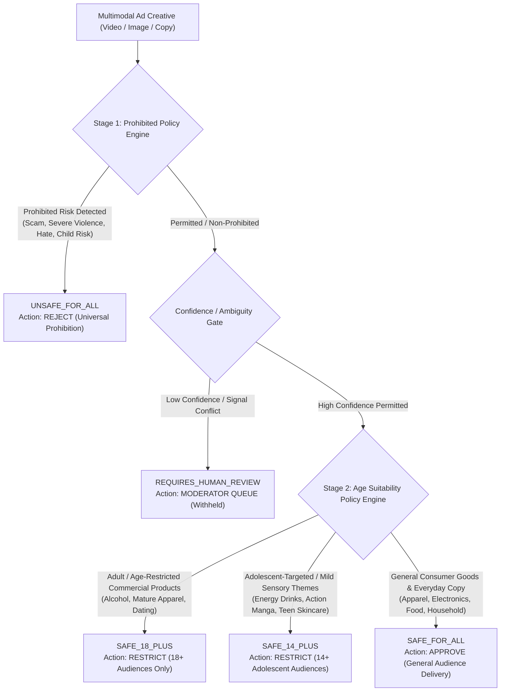

# SAFE-VISION — Four-Category Advertising Moderation Policy Justification

**Project**: SAFE-VISION (SafeAd AI Multimodal Advertisement Moderation System)  
**Document**: Four-Category Policy Framework & Traceable Regulatory Evidence  
**Date**: October 22, 2026  
**Status**: ACADEMICALLY DEFENDED & POLICY-ALIGNED  

---

## 1. Executive Policy Framework

SAFE-VISION categorizes commercial multimodal advertisements into four operational moderation tiers. This taxonomy is designed to bridge the gap between binary compliance filtering ("allow" vs "block") and nuanced jurisdictional age gating.

---

## 2. Definitive Category Specifications & Authoritative Sources

### 2.1 Category 1: `SAFE_FOR_ALL` (General Commercial Audiences)
* **Operational Definition**: Ordinary commercial advertising promoting general goods, services, or brand messaging that contains no age-restricted goods, no suggestive sexualized content, no graphic violence, and no deceptive marketing claims. Suitable for unrestricted distribution to all demographic cohorts, including young children (<14).
* **Scope**: Everyday apparel, general footwear, consumer electronics, family dining, educational apps, household appliances, and non-stimulant groceries.
* **Authoritative Policy Citations**:
  1. **Google Ads Advertising Policies**: General audience commercial standards. Ad creatives must be family-safe and suitable for general display network audiences.  
     *Reference*: [Google Ads Policies — Editorial & Professional Requirements](https://support.google.com/adspolicy/answer/6008942)
  2. **International Age Rating Coalition (IARC)**: Rating category `General` / `Everyone` (ESRB: Everyone; PEGI: 3/7). Content containing no material requiring parental intervention.  
     *Reference*: [IARC Ratings Guide & Content Descriptors](https://www.globalratings.com/ratings-guide.aspx)
  3. **Meta Advertising Standards**: Unrestricted community advertising guidelines.  
     *Reference*: [Meta Advertising Standards — Community Values](https://transparency.meta.com/policies/ad-standards/)

---

### 2.2 Category 2: `SAFE_14_PLUS` (Adolescent Tier — Project-Defined Boundary)
* **Operational Definition**: Advertisements promoting products, media, or themes that are permissible for adolescents and teenagers (ages 14 and older) but unsuitable for unaccompanied child audiences (<14). This encompasses mild sensory/intensity themes, mild caffeine or energy stimulants, mild competitive/stylized combat, acne and blemish cosmetics, and adolescent-focused lifestyle brands.
* **Critical Academic Disclosure**:
  > [!IMPORTANT]
  > **14+ is a project-defined age boundary**, established to align with global youth privacy thresholds (e.g., FTC COPPA under-13 boundary and Indian DPDP Act minor threshold) and adolescent media rating systems (e.g., ESRB `Teen` [13+], PEGI `12`/`16`, BBFC `12A`). **No single universal advertising treaty codifies 14+ as an international statutory standard**. It functions in SAFE-VISION as a defensible engineering tier between child-protective general advertising and lawful adult-restricted commerce.
* **Scope**: Highly caffeinated energy beverages (>150 mg caffeine), teen cosmetic treatments (active salicylic acid, blemish serums), stylized martial arts / fantasy action media, mature teen video games, and adolescent fashion.
* **Authoritative Policy Citations**:
  1. **IARC / ESRB Rating Definition for Teen (13+) & PEGI 12**: May contain violence, suggestive themes, crude humor, minimal blood, and/or infrequent use of strong language.  
     *Reference*: [IARC Content Descriptor Guidelines](https://www.globalratings.com/ratings-guide.aspx)
  2. **UK Advertising Standards Authority (ASA) & CAP Code**: Rule 15.18 regarding high-caffeine beverages and energy drinks requiring age-targeting restrictions away from primary school children.  
     *Reference*: [ASA Committee of Advertising Practice (CAP) Code — Food and Soft Drink Advertising](https://www.asa.org.uk/codes-and-rulings/advertising-codes/non-broadcast-code.html)
  3. **FTC Children's Online Privacy Protection Act (COPPA)**: 15 U.S.C. §§ 6501–6506, setting age 13 as the legal boundary for child-directed personal data collection and profiling in digital platforms.  
     *Reference*: [FTC COPPA Enforcement & Guidelines](https://www.ftc.gov/legal-library/browse/rules/childrens-online-privacy-protection-rule-coppa)

---

### 2.3 Category 3: `SAFE_18_PLUS` (Lawful Adult-Restricted Content)
* **Operational Definition**: Legitimate, lawful commercial advertising for products or services that are legally restricted to adult consumers (age 18 and older) by statute or platform policy. This includes alcoholic beverages, adult dating applications, licensed gambling/lottery operations, mature sexual wellness products, prescription/regulated substances, and adult lingerie/swimwear.
* **Operational Mandate**: Content is lawful to publish but strictly requires affirmative age verification; delivery to minors (<18) constitutes a severe regulatory violation.
* **Scope**: Beer, wine, and spirits; adult apparel and swimwear; licensed sports betting; cosmetic medical procedures; mature romantic dating platforms.
* **Authoritative Policy Citations**:
  1. **Google Ads Alcohol Policy**: Strict geographical and age-gating restrictions. Prohibits targeting alcohol ads to individuals below the legal drinking age; prohibits depicting minors consuming alcohol.  
     *Reference*: [Google Ads Policy — Alcohol](https://support.google.com/adspolicy/answer/6018017)
  2. **Meta Advertising Standards — Restricted Goods and Services**: Mandatory 18+ audience gating for alcohol, online gaming/gambling, cosmetic surgery, and weight-loss products.  
     *Reference*: [Meta Ad Standards — Restricted Goods & Services](https://transparency.meta.com/policies/ad-standards/restricted-goods-services/)
  3. **IARC Rating Definition for Mature (17+/18+) & PEGI 18**: Content with intense violence, blood and gore, sexual content, and/or strong language.  
     *Reference*: [IARC Rating Categories](https://www.globalratings.com/ratings-guide.aspx)

---

### 2.4 Category 4: `UNSAFE_FOR_ALL` (Prohibited Content & Universal Rejection)
* **Operational Definition**: Advertisements containing universally unlawful, deceptive, fraudulent, or hazardous content that is prohibited from publication on digital platforms regardless of audience age. Such content is immediately rejected and withheld from ad serving.
* **Scope**: Financial scams, cryptocurrency pump-and-dump schemes, phishing campaigns, deceptive "guaranteed return" marketing, extreme graphic violence, hate speech, weapons/illicit drugs, and child sexual abuse or exploitation.
* **Authoritative Policy Citations**:
  1. **Federal Trade Commission (FTC) Policy Statement on Deception**: Deceptive acts or practices under Section 5(a) of the FTC Act (15 U.S.C. § 45). Material representations or omissions likely to mislead a reasonable consumer.  
     *Reference*: [FTC Policy Statement on Deception](https://www.ftc.gov/legal-library/browse/ftc-policy-statement-on-deception)
  2. **Google Ads Policies — Prohibited Content & Dishonest Behavior**: Universal prohibitions on counterfeit goods, dangerous products, enabling dishonest behavior, and inappropriate/hateful content.  
     *Reference*: [Google Ads Policy — Prohibited Content](https://support.google.com/adspolicy/answer/6015406)
  3. **Meta Advertising Standards — Unacceptable Content**: Absolute prohibition of fraud, scams, discriminatory practices, weapon sales, and exploitation.  
     *Reference*: [Meta Ad Standards — Unacceptable Content](https://transparency.meta.com/policies/ad-standards/unacceptable-content/)
  4. **NIST AI Risk Management Framework (NIST AI 100-1)**: Section 1.2 on AI safety, risk identification, and harm prevention across automated content recommendation and moderation systems.  
     *Reference*: [NIST AI RMF 1.0](https://www.nist.gov/itl/ai-risk-management-framework)
  5. **ISO 31000:2018 (Risk Management — Guidelines)**: Clause 5.4 on establishing risk criteria, defining consequence severity, and enforcing zero-tolerance risk treatment protocols for severe legal compliance threats.  
     *Reference*: [ISO 31000 Risk Management Standard](https://www.iso.org/standard/65694.html)

---

## 3. Disconnection Between Policy Categories and Numerical Risk Scoring

> [!CAUTION]
> **Essential Academic Caveat**:
> No international standard (neither IARC, FTC, ISO, nor NIST) prescribes SAFE-VISION's exact linear weights ($0.25, 0.20, 0.20, 0.15, 0.10, 0.10$) or numerical thresholds ($25.0, 50.0$).
> 
> The four categories are **grounded in statutory law and platform advertising policy**. Conversely, the numerical scoring equation and threshold bands are **empirical, development-calibrated heuristics**. Conflating policy legitimacy with heuristic threshold numbers is scientifically invalid.

1. **Policy Grounding vs Empirical Thresholds**:
   - The *categories* represent discrete, legally mandated regulatory states.
   - The *numerical scores* represent raw detector feature outputs mapped to an ad-hoc 0–100 scale.
2. **Failure of 1D Monotonic Continuum**:
   - Prohibited advertising (`UNSAFE_FOR_ALL`) is NOT simply an extreme version of adult advertising (`SAFE_18_PLUS`). A completely non-sexual, low-risk-looking investment scam ad can carry catastrophic legal liability while exhibiting a low visual risk score.
   - Therefore, a two-stage hybrid architecture—hard policy checks for prohibition followed by domain attribute gating for age—is mathematically and policy-wise necessary.
